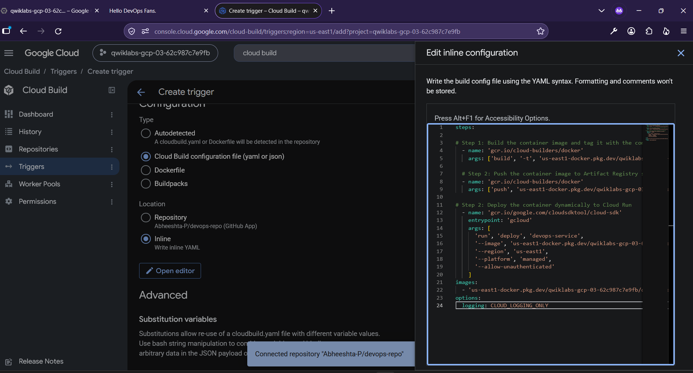
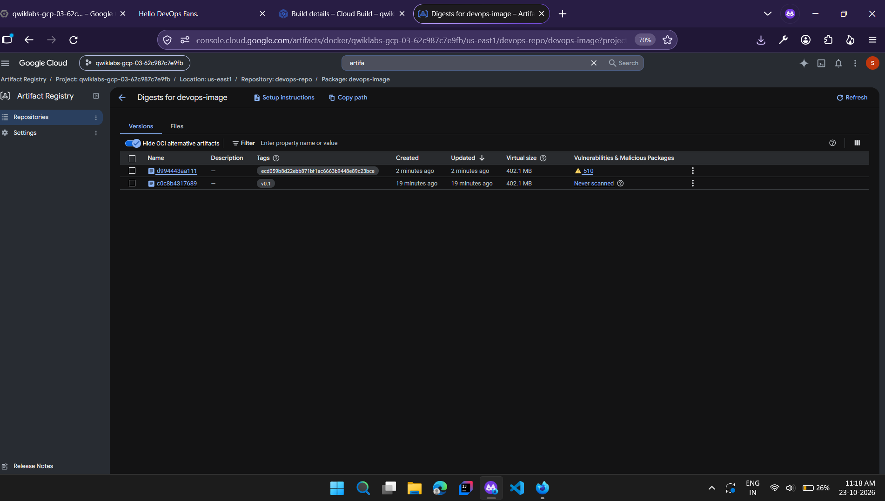
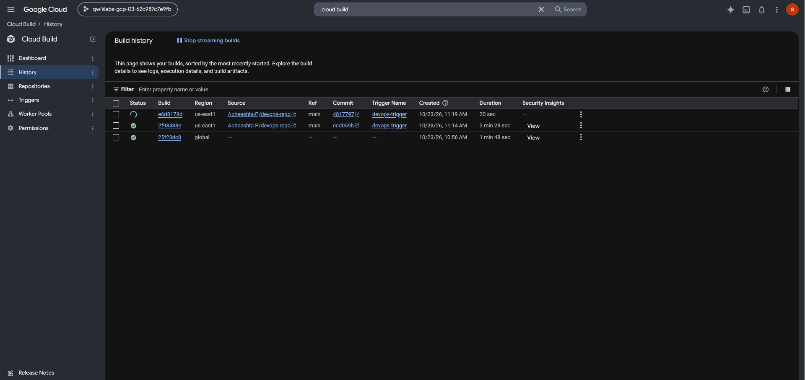
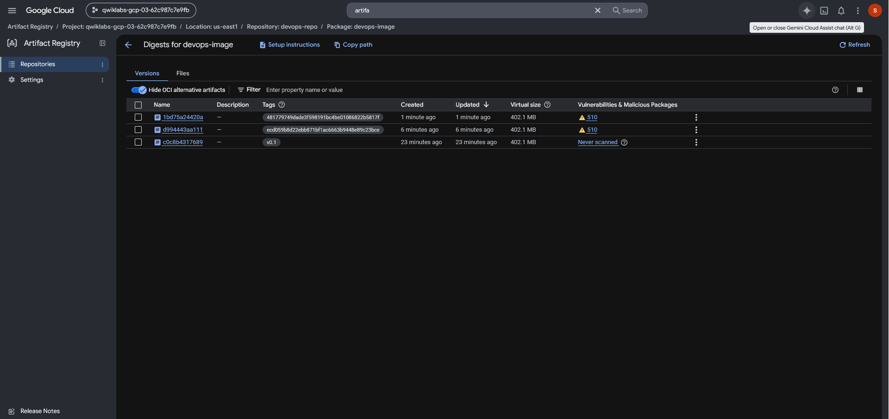

# Python Flask CI/CD Pipeline on Google Cloud

A beginner-friendly DevOps project that builds a Python Flask
application, packages it as a Docker image, stores the image in Google
Artifact Registry, deploys it to Cloud Run, and automates future
deployments with Cloud Build triggers connected to GitHub.

## What this project teaches

-   **Python Flask** --- creates the web application.
-   **Git and GitHub** --- version control and source-code hosting.
-   **Docker** --- defines a repeatable container image using a
    `Dockerfile`.
-   **Cloud Build** --- builds the image and runs the CI/CD pipeline.
-   **Artifact Registry** --- stores versioned Docker images.
-   **Cloud Run** --- runs the container as a managed serverless
    service.
-   **Cloud Build triggers** --- start builds automatically when code is
    pushed to a connected GitHub repository.
-   **Cloud Shell and `gcloud` CLI** --- run Google Cloud commands from
    a browser-based terminal.

## How the pieces fit together

``` text
Write Python code
       |
       v
Git commit and push to GitHub
       |
       v
Cloud Build trigger runs
       |
       +--> Build Docker image
       |
       +--> Push image to Artifact Registry
       |
       +--> Deploy image to Cloud Run
       |
       v
Open the Cloud Run service URL
```

## Key terms

  -----------------------------------------------------------------------
  Tool                                What it does in this project
  ----------------------------------- -----------------------------------
  **Git**                             Tracks code changes locally through
                                      commits.

  **GitHub**                          Hosts the repository and receives
                                      pushes.

  **Terminal / Cloud Shell**          Lets you run commands such as
                                      `git`, `gh`, and `gcloud`. Cloud
                                      Shell is a browser-based terminal
                                      in Google Cloud Console.

  **Dockerfile**                      Instructions for packaging the app
                                      and its dependencies into an image.

  **Docker image**                    The packaged application template
                                      used to create a running container.

  **Cloud Build**                     Builds the container image and
                                      executes pipeline steps.

  **Artifact Registry**               Stores the built image so Cloud Run
                                      can retrieve it.

  **Cloud Run**                       Runs the container without
                                      requiring you to manage servers.

  **Build trigger**                   Connects repository changes to an
                                      automated build and deployment.

  **`gcloud` CLI**                    Command-line tool for managing
                                      Google Cloud resources.

  **Terraform (optional)**            Can later define cloud resources as
                                      code. It is not required for the
                                      lab's basic pipeline.
  -----------------------------------------------------------------------

## Project tasks

1.  **Set up GitHub and Cloud Shell**
    -   Authenticate the Google Cloud CLI and GitHub CLI.
    -   Create a GitHub repository and clone it into Cloud Shell.
2.  **Create the Python application**
    -   Build a simple Flask app in `main.py`.
    -   Add HTML templates and list dependencies in `requirements.txt`.
3.  **Define the Docker image**
    -   Create a `Dockerfile` that installs the dependencies and runs
        the app with Gunicorn.
4.  **Build and store the image**
    -   Create a Docker repository in Artifact Registry.
    -   Use Cloud Build to build the image and push it to Artifact
        Registry.
5.  **Deploy the app**
    -   Deploy the image to Cloud Run.
    -   Open the service URL and verify the page displays
        `Hello DevOps Fans.`
6.  **Automate CI/CD**
    -   Connect the GitHub repository to Cloud Build.
    -   Configure a build trigger and a Cloud Build configuration.
    -   Build, push, and deploy a new image when code changes are
        pushed.
7.  **Test the pipeline**
    -   Change the page text to `Hello Build Trigger.`
    -   Commit and push the change.
    -   Check Cloud Build history and confirm the live Cloud Run service
        updates.

## Useful commands

``` bash
# Check the active project ID in Cloud Shell
echo "$DEVSHELL_PROJECT_ID"

# Move to the project repository
cd ~/gcp-course/devops-repo

# Stage, commit, and push changes
git add --all
git commit -m "Describe your change"
git push origin main
```

The lab also uses `gh` to authenticate and create a GitHub repository,
and `gcloud` to create the Artifact Registry repository, build images,
configure Docker authentication, and deploy to Cloud Run.

## Notes

-   Follow the lab's specified region consistently for Artifact
    Registry, Cloud Build, and Cloud Run.
-   Use the project ID supplied by your own lab/account. Do not copy a
    project ID or service-account email from an example.
-   The lab environment may provide temporary resources and credentials.
    Never commit credentials, tokens, or service-account keys to GitHub.
-   If using your own Google Cloud account, check billing and current
    pricing before enabling services. Delete resources when finished to
    avoid unexpected charges.
-   This starter project does not require Terraform. Add Terraform later
    if you want to practice managing infrastructure as code.

## Learning outcome

By completing this project, you will understand the path from a Python
code change to a deployed cloud application, including source control,
containerization, image storage, CI/CD automation, and serverless
hosting.

## Screenshots




